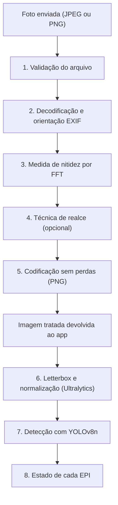
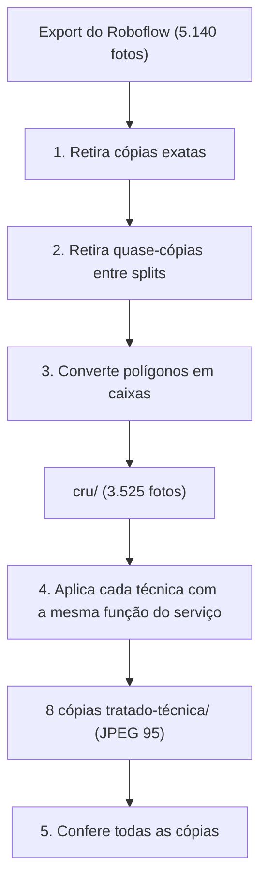
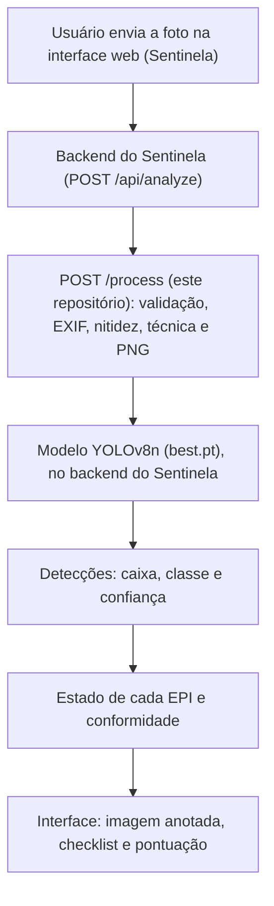

# Análise Visual de Equipamentos de Proteção Individual (EPIs) com Visão Computacional e IA Generativa

Projeto acadêmico integrado entre as disciplinas de **Processamento de Imagens e Sinais** e **Inteligência Artificial / IA Generativa**.

---

## Status do Projeto

Esta versão corresponde à entrega de **Processamento de Imagens** de 16/11/2026.

- **Neste repositório:** o serviço de processamento de imagens (`POST /process`), com testes; a avaliação A/B das técnicas de realce com o modelo treinado (`best.pt`, um YOLOv8n); e o script que gera o dataset tratado da fase 2, publicado na [Release `dataset-fase2-v1`](https://github.com/Projeto-Semestre-6/epi-computer-vision-genai/releases/tag/dataset-fase2-v1).
- **No projeto da disciplina de IA:** a aplicação [Sentinela](https://github.com/Projeto-Semestre-6/sentinela-epi-identificador), com o modelo YOLOv8n e a interface web. O backend dela envia cada foto ao nosso `POST /process` antes da detecção.
- **Ainda não feito:** o treino comparativo com o dataset tratado, a escolha da técnica padrão a partir dele e a avaliação final no split de teste.

---

## Integrantes

- Abner Wallace da Costa Rodrigues — RA 24111862
- Elidio Giacon Neto — RA 24111663
- Guilherme Martins Messa — RA 24111940
- Maria Antonia Rodrigues Vieira — RA 24111894
- Victor Silva Murakami — RA 24111697
- Vinicius Henrique Dalaqua da Silva — RA 24111678

---

## Descrição do Projeto

### Problema

A verificação do uso correto de Equipamentos de Proteção Individual em ambientes de trabalho é normalmente feita por inspeção humana, o que é trabalhoso, sujeito a falhas de atenção e difícil de registrar de forma padronizada.

### Proposta

Um protótipo acadêmico que:

1. recebe a foto de um trabalhador;
2. trata a imagem para o modelo (este repositório);
3. identifica, com um modelo de detecção de objetos, a presença ou a ausência explícita de cada EPI;
4. mostra o resultado estruturado: o estado de cada EPI e a conformidade.

### Objetivo

Demonstrar, de ponta a ponta, a integração entre uma etapa de processamento de imagens e um modelo de IA de detecção, com responsabilidades separadas: o processamento prepara a imagem, e o modelo identifica os EPIs.

### Escopo do MVP

- uma imagem de entrada;
- um trabalhador principal por imagem;
- três EPIs avaliados: **capacete**, **colete** e **óculos de proteção**;
- saída estruturada: estado de cada EPI.

### Relevância

O tema exige um pipeline completo e realista: dataset anotado, tratamento de imagens, detecção de objetos e interpretação dos resultados.

**Importante:** trata-se de um **protótipo acadêmico**, não de um sistema industrial ou certificado de segurança do trabalho. Os resultados automáticos possuem limitações e não devem ser usados como base para decisões reais de segurança.

---

## Escopo

**Dentro do escopo:**

- um trabalhador principal por imagem (sem associação de EPIs a múltiplas pessoas);
- classes positivas: `helmet`, `vest`, `goggles`;
- classes negativas explícitas: `no-helmet`, `no-vest`, `no-goggles`.

**Sobre as classes negativas:** o dataset possui anotações explícitas de ausência. Elas são usadas justamente para **evitar a inferência incorreta de que "não detectado" é o mesmo que "ausente"**. Uma detecção ausente pode significar apenas falha do modelo, oclusão ou baixa confiança.

**Fora do escopo:**

- `boots` / `no-boots` e `gloves` / `no-gloves` nas métricas do projeto (os rótulos continuam no dataset);
- múltiplas pessoas por imagem;
- vídeo ou processamento em tempo real.

---

## Dataset

### Dataset original

- **Nome:** PPE detection — dam
- **Plataforma:** Roboflow Universe
- **Link:** https://universe.roboflow.com/dam-zapvl/ppe-detection-qlq3d-i0ezw
- **Licença:** CC BY 4.0

**Características do export usado (versão 1):**

- **5.140 imagens**: 3.597 de treino, 1.026 de validação e 517 de teste;
- tarefa de **Object Detection**, com anotações em **bounding boxes** no formato YOLO (algumas linhas vieram em polígono);
- 10 classes: `helmet`, `vest`, `goggles`, `boots`, `gloves`, `no-helmet`, `no-vest`, `no-goggles`, `no-boots`, `no-gloves`.

As métricas do projeto usam as 6 classes do escopo: `helmet`, `no-helmet`, `vest`, `no-vest`, `goggles`, `no-goggles`.

### Dataset tratado (fase 2)

- **Link:** [Release `dataset-fase2-v1`](https://github.com/Projeto-Semestre-6/epi-computer-vision-genai/releases/tag/dataset-fase2-v1)
- **Conteúdo:** as mesmas 3.525 fotos (2.165 de treino, 843 de validação e 517 de teste) em 9 cópias: `cru.zip`, com as fotos originais, e um `tratado-<técnica>.zip` para cada técnica do serviço. A página da Release explica cada arquivo.
- **Como foi gerado:** pelo pipeline descrito em **Pipeline do dataset tratado**, mais abaixo.

### Como os dados foram usados

- **Fase 1 (avaliação A/B):** o split de validação original (1.026 fotos). O split de teste não foi usado.
- **Fase 2 (dataset tratado):** as fotos repetidas entre os splits foram retiradas antes de qualquer treino, para que a validação não tenha cópias de fotos do treino.
- **Teste:** fica guardado para uma única medida final, depois de escolhida a técnica.

---

## Pipeline de Processamento de Imagens

O tratamento é feito por uma única função (`pipeline.process_image`), usada pelo serviço, pela avaliação A/B e pelo lote que gerou o dataset tratado. Assim, uma foto passa pelas mesmas etapas em qualquer um dos três.



As etapas 1 a 5 acontecem neste repositório. As etapas 6 a 8 acontecem no backend do Sentinela, o projeto da disciplina de IA.

**Etapa 1 — Validação do arquivo.** O formato é identificado pelos primeiros bytes do conteúdo, não pela extensão. São recusados: arquivos vazios ou corrompidos, formatos diferentes de JPEG e PNG, arquivos acima de 10 MiB e imagens acima de 40 milhões de pixels.

**Etapa 2 — Decodificação e orientação EXIF.** A imagem vira uma matriz de pixels com 3 canais de 8 bits. Celulares gravam a foto "deitada" e indicam o giro na tag EXIF Orientation; o serviço gira ou espelha os pixels para deixar a foto em pé. Transparência é descartada, tons de cinza viram 3 canais iguais e PNG de 16 bits vira 8 bits, as mesmas conversões que o Ultralytics faz ao ler um arquivo.

**Etapa 3 — Medida de nitidez por FFT.** O serviço calcula a fração da energia do espectro de Fourier acima de 0,25 ciclo/pixel, numa versão em tons de cinza com o lado maior em 640 px, a escala que o modelo enxerga. Altas frequências são bordas e detalhes; uma foto borrada concentra a energia nas baixas frequências e tem valor menor. A medida é feita antes da técnica e devolvida no cabeçalho `X-Sharpness-HF-Ratio`. Ainda não há limiar calibrado: o valor é só informativo.

**Etapa 4 — Técnica de realce (opcional).** Aplica uma das técnicas abaixo, escolhida no parâmetro `technique`. O padrão é `none`, porque nenhuma técnica passou na avaliação A/B da fase 1. As técnicas de contraste e nitidez agem só na luminosidade (canal L do espaço de cor CIELAB), para não alterar as cores, que ajudam a reconhecer o colete. Os parâmetros de vizinhança (sigma e frequência de corte) são definidos na escala de 640 px e convertidos para a resolução da foto, para que uma foto grande receba o mesmo efeito que o modelo veria numa pequena. Nenhuma técnica muda o tamanho da imagem.

| Técnica | Domínio | O que faz | Parâmetros |
|---|---|---|---|
| `none` | n/a | Nenhum tratamento. É a referência. | n/a |
| `histogram_equalization` | espacial | Espalha os tons da foto inteira e aumenta o contraste geral. | equalização global da luminância |
| `clahe` | espacial | Aumenta o contraste por regiões, com limite, e realça detalhes em áreas muito escuras ou muito claras. | limite 2,0, grade 8×8 |
| `gamma` | espacial | Clareia sombras e tons médios: `s = 255 · (r / 255)^0,8`. | gama 0,8, em cada canal |
| `gaussian_blur` | espacial | Suaviza a foto e tira ruído e detalhes finos. | sigma 1,0 px |
| `unsharp_mask` | espacial | Reforça bordas somando a diferença entre a foto e uma versão suavizada: `g = f + (f − suavizada)`. | sigma 1,0 px, intensidade 1,0 |
| `fft_lowpass` | frequência | Filtro passa-baixas gaussiano no espectro: atenua as altas frequências (detalhes finos e ruído). | corte 0,25 ciclo/pixel |
| `fft_high_emphasis` | frequência | Ênfase de altas frequências, `H = 1 + 0,5 · (1 − passa-baixas gaussiano)`: reforça bordas e mantém o resto. | corte 0,1 ciclo/pixel |

**Etapa 5 — Codificação.** O resultado é devolvido como PNG sem perdas, do mesmo tamanho da foto já orientada e sem metadados. Como o tamanho não muda, a imagem tratada tem as mesmas coordenadas da foto original. No dataset tratado, a mesma função grava JPEG de qualidade 95.

**Etapa 6 — Letterbox e normalização.** No backend do Sentinela, fotos com lado maior acima de 1.920 px são reduzidas, e o Ultralytics redimensiona a imagem até o lado maior ter 640 px, preservando a proporção e preenchendo as bordas, e normaliza os valores de pixel. O nosso serviço não redimensiona, para não repetir essa etapa.

**Etapa 7 — Detecção com YOLOv8n.** O modelo analisa a imagem inteira numa única passagem e devolve caixas, cada uma com classe e confiança. Caixas redundantes sobre o mesmo objeto são eliminadas por *Non-Maximum Suppression* (NMS).

**Etapa 8 — Estado de cada EPI.** As detecções abaixo do limiar de confiança escolhido na interface são descartadas, e cada EPI recebe um estado: **identificado** (classe positiva detectada), **ausência** (classe negativa detectada, como `no-helmet`) ou **indeterminado** (nenhuma das duas). Se o mesmo EPI aparecer como presente e ausente, a aplicação usa a detecção de maior confiança. Exemplo de saída:

```text
capacete: identificado
colete:   identificado
oculos:   ausencia
```

> **Nota sobre o framework:** o letterbox, o NMS e a execução da inferência são feitos internamente pelo **Ultralytics** e não foram reimplementados. O esforço deste repositório está no tratamento da imagem, na sua avaliação e na preparação do dataset.

### Pipeline do dataset tratado

O script `scripts/build_phase2_dataset.py` gera o dataset da fase 2 a partir do export do Roboflow, que só é lido e nunca alterado. Os comandos ficam no início do script.



1. **Cópias exatas:** fotos com o mesmo conteúdo (mesmo SHA-256) ficam uma vez só. Saíram 79, com prioridade teste > validação > treino.
2. **Quase-cópias entre splits:** duas fotos são comparadas por miniaturas 64×64 em tons de cinza, pela diferença média absoluta entre elas, a menor entre os 8 espelhamentos e giros de 90° de uma delas. Até 2,0, numa escala de 0 a 255, são quase-cópias, e sai a do split de menor prioridade. Saíram 1.536 (1.358 do treino e 178 da validação). O limiar foi escolhido depois de olhar uma folha com os pares encontrados.
3. **Polígonos:** as linhas de rótulo em polígono viram a caixa que envolve os pontos. O resto dos rótulos fica igual, byte a byte.
4. **Tratamento:** cada técnica gera uma cópia completa, com os mesmos nomes de arquivo e os mesmos rótulos de `cru/`.
5. **Conferência:** o comando `verify` confere bytes, rótulos, nomes das classes e a seleção de fotos em todas as cópias.

---

## Metodologia de Visão Computacional

- **Tipo de problema:** Object Detection.
- **Modelo:** YOLOv8n (variante *nano*), com **pesos pré-treinados** (`yolov8n.pt`).
- **Framework:** Ultralytics.
- **Estratégia de treinamento:** Transfer Learning / fine-tuning a partir dos pesos pré-treinados — a rede **não** é treinada do zero.

**Por que Object Detection.** O dataset já é anotado com *bounding boxes*. Converter o problema para classificação de imagem descartaria a informação de localização, sem simplificar o projeto de forma relevante. Além disso, a detecção permite tratar cada EPI como um objeto independente na cena.

**Por que YOLOv8n com transfer learning.** Os pesos pré-treinados já codificam características visuais genéricas, o que reduz a quantidade de dados e de tempo de treinamento necessários. A variante *nano* é a mais leve da família, adequada ao hardware disponível e ao prazo do projeto acadêmico.

> **Mudança em relação ao planejamento:** a primeira versão deste README previa o YOLO11n. O único treino feito foi com o YOLOv8n, e retreinar não cabia no prazo. A família, o framework (Ultralytics) e as etapas do pipeline são os mesmos.

---

## Serviço de processamento de imagens (este repositório)

O serviço recebe a foto, executa as etapas 1 a 5 do pipeline e devolve um PNG. O contrato completo (parâmetros, cabeçalhos e erros) está em [`docs/contrato-api.md`](docs/contrato-api.md).

**Como o Sentinela usa o serviço.** O backend do Sentinela envia cada foto ao `POST /process`, com a técnica definida na variável `IMGPROC_TECHNIQUE` (hoje `none`), e passa o PNG devolvido ao modelo. Se o serviço estiver fora do ar ou recusar a foto, o backend usa a imagem original, para a análise não parar.

**Como rodar** (Python 3.14; a porta padrão do serviço é a 8001):

```bash
python3.14 -m venv .venv
.venv/bin/pip install -r requirements.txt
.venv/bin/python -m pytest
.venv/bin/python -m uvicorn --app-dir src epi_imgproc.api:app --port 8001
```

Para testar sem o Sentinela:

```bash
curl -sS -D - -o processada.png -F "file=@foto.jpg" "http://localhost:8001/process?technique=clahe"
```

### Avaliação A/B das técnicas de pré-processamento (fase 1)

**Pergunta:** algum tratamento de imagem melhora o modelo já treinado? Avaliamos a linha de base e 7 técnicas nas 1.026 imagens do split de validação (versão 1 do dataset no Roboflow). Todas passaram pelo mesmo pipeline do serviço, com o mesmo `best.pt`. O split de teste não foi usado.

**Regra, registrada antes da rodada:** uma técnica só vira padrão se o mAP50 das 6 classes do escopo subir e o recall de nenhuma delas cair, em relação à linha de base.

| Técnica | mAP50 (6 classes) | recall helmet | recall no-helmet | recall vest | recall no-vest | recall goggles | recall no-goggles | Veredito |
|---|---|---|---|---|---|---|---|---|
| nenhuma (`none`, linha de base) | 0,6804 | 0,9486 | 0,2913 | 0,9489 | 0,7798 | 0,6814 | 0,5677 | n/a |
| equalização de histograma | 0,6727 | 0,9495 | 0,3107 | 0,9463 | 0,7752 | 0,6195 | 0,4968 | reprovada |
| CLAHE | 0,6770 | 0,9486 | 0,3107 | 0,9419 | 0,7752 | 0,6460 | 0,5871 | reprovada |
| correção gama (0,8) | 0,6789 | 0,9520 | 0,3204 | 0,9445 | 0,7936 | 0,6903 | 0,5419 | reprovada |
| suavização gaussiana | 0,6743 | 0,9334 | 0,2913 | 0,9419 | 0,7844 | 0,6106 | 0,5613 | reprovada |
| unsharp mask | 0,6768 | 0,9478 | 0,3107 | 0,9541 | 0,7569 | 0,6726 | 0,5484 | reprovada |
| passa-baixa FFT | 0,6809 | 0,9469 | 0,2913 | 0,9445 | 0,7890 | 0,6372 | 0,5613 | reprovada |
| ênfase de altas frequências FFT | 0,6785 | 0,9495 | 0,3010 | 0,9489 | 0,7706 | 0,6903 | 0,5806 | reprovada |

Como cada métrica foi medida:

- **mAP50:** validação padrão do Ultralytics (`model.val`), com conf 0,001, IoU do NMS 0,7, `imgsz` 640, `rect` e `max_det` 300. A coluna é a média do AP50 das 6 classes do escopo.
- **Recall:** contagem exata, nas predições dessa mesma validação. Para cada classe, conta as predições com confiança ≥ 0,25 que o Ultralytics casou com uma caixa anotada da mesma classe com IoU ≥ 0,5 e divide pelo número de caixas anotadas da classe.

**Resultado:** nenhuma das 7 técnicas, com os parâmetros testados, passou na regra. Por isso o serviço entrega, por padrão, a imagem sem tratamento (`technique=none`). O passa-baixa FFT foi o único a subir o mAP50, em menos de 0,001 (0,6809 contra 0,6804), mas o recall de 4 classes caiu.

**Por que a fase 2.** O modelo foi treinado com fotos sem tratamento, então uma técnica aplicada só na hora da detecção mostra ao modelo imagens diferentes das que ele aprendeu. A fase 2 treina um modelo em cada cópia do dataset tratado e compara cada uma com `cru` e `tratado-none` (o controle, que só regrava a foto em JPEG).

Detalhes da avaliação:

- O script é `scripts/run_ab_eval.py`. As 8 rodadas avaliaram as 1.026 imagens, conforme a contagem do próprio Ultralytics, e a linha de base é idêntica pixel a pixel ao que o Ultralytics leria do arquivo original.
- Na cópia dos rótulos usada na avaliação, 16 anotações em polígono foram convertidas em caixas (a mesma regra do Ultralytics). Sem isso, o Ultralytics descartaria 6 imagens.
- A versão do dataset usada no treino do `best.pt` não foi confirmada (o checkpoint aponta `PPE-detection-1`). Além disso, a fase 2 encontrou 1.536 quase-cópias entre os splits desse export. Por isso os valores absolutos podem estar otimistas, e as técnicas são comparadas só entre si.
- Há uma única divisão de validação, e as diferenças de mAP50 em relação à linha de base ficam entre −0,0078 e +0,00045. Diferenças dessa ordem podem ser ruído.

### Decisões tomadas depois do planejamento

| Decisão | Motivo |
| --- | --- |
| Modelo YOLOv8n no lugar do YOLO11n previsto | O único treino feito foi com o YOLOv8n (ver **Metodologia de Visão Computacional**). |
| Processamento de imagens neste repositório; modelo e interface no Sentinela | Divisão do trabalho no grupo; o contrato entre os dois está em `docs/contrato-api.md`. |
| Porta padrão 8001 para o nosso serviço | O backend do Sentinela usa a 8000, e os dois podem rodar na mesma máquina. |
| Retirar as fotos repetidas entre os splits antes do treino da fase 2 | Foto do treino repetida na validação deixa o resultado otimista. |
| Dataset tratado distribuído numa Release, fora do git | São cerca de 5 GB de imagens, e o repositório guarda só o código que as gera. |

---

## Integração com Inteligência Artificial

A disciplina de IA é atendida pela aplicação [Sentinela](https://github.com/Projeto-Semestre-6/sentinela-epi-identificador): um backend FastAPI que carrega o modelo YOLOv8n treinado (`best.pt`) e uma interface web. Este repositório é a etapa de processamento de imagens que o Sentinela chama antes da detecção.

### Pipeline completo



### Responsabilidades

| Componente | Onde | Responsabilidade |
| --- | --- | --- |
| **Processamento de imagens** | este repositório | Validar a foto, corrigir a orientação, medir a nitidez e aplicar a técnica de realce. |
| **Modelo de IA (YOLOv8n)** | Sentinela | Detectar cada EPI, presente ou ausente, com caixa e confiança. |
| **Interpretação e interface** | Sentinela | Transformar as detecções no estado de cada EPI e na conformidade, e mostrar o resultado ao usuário. |

### Sobre a IA Generativa

O planejamento inicial previa uma etapa em que um modelo de IA Generativa (LLM) receberia o resultado estruturado e escreveria um relatório de orientação. Essa etapa não foi implementada: o Sentinela mostra o resultado estruturado diretamente na interface, sem geração de texto, e nenhuma API de LLM é usada no sistema. O nome do projeto foi mantido.

---

## Limitações e cuidados

- **`goggles` é uma classe visualmente mais difícil:** óculos de proteção são objetos pequenos, frequentemente transparentes e sujeitos a oclusão, o que tende a reduzir a qualidade da detecção.
- **Classes fracas na validação:** com o `best.pt`, o recall é de 0,29 em `no-helmet`, 0,57 em `no-goggles` e 0,68 em `goggles` (seção **Serviço de processamento de imagens**). A maioria das ausências de capacete anotadas não é detectada, e, quando nenhuma das duas classes aparece, o estado fica indeterminado.
- **Anotações inconsistentes no dataset original:** em 328 das 1.536 quase-cópias retiradas na fase 2, a foto retirada e a sua quase-cópia tinham quantidades diferentes de caixas nas 6 classes do escopo, principalmente em `no-helmet` e `helmet`. Isso reduz a confiabilidade das métricas de capacete.
- **Fotos parecidas que continuam:** a fase 2 retirou só as quase-cópias entre splits até o limiar. Fotos parecidas dentro do mesmo split continuam, e quadros do mesmo vídeo podem estar em splits diferentes quando a diferença passa do limiar.
- **Ausência de detecção ≠ ausência real:** a não detecção de uma classe positiva não é tratada como comprovação de que o EPI não está sendo usado.
- **Protótipo acadêmico:** o sistema não é uma solução certificada de segurança do trabalho e não substitui inspeção humana.

---

## Tecnologias

- Python 3.14
- Ultralytics / YOLOv8n (PyTorch)
- OpenCV, NumPy e Pillow
- FastAPI e uvicorn (serviço REST)
- pytest (testes)

As versões usadas estão fixadas no [`requirements.txt`](requirements.txt).

---

## Próximas etapas

1. Treinar o mesmo modelo em `cru`, `tratado-none` e nas cópias tratadas, com a mesma configuração, e comparar na validação de cada cópia.
2. Tornar padrão a técnica vencedora, no serviço e na variável `IMGPROC_TECHNIQUE` do Sentinela, para a API tratar cada foto como as fotos do treino.
3. Medir o modelo escolhido uma única vez no split de teste.

---

## Checklist da entrega

| Requisito do professor | Onde foi atendido |
| --- | --- |
| 1. Nome completo dos integrantes | Seção **Integrantes** |
| 2. Descrição detalhada do projeto, com o pipeline de processamento de imagens e explicação de cada etapa | Seções **Descrição do Projeto**, **Escopo**, **Pipeline de Processamento de Imagens** (etapas 1 a 8 e pipeline do dataset tratado) e **Serviço de processamento de imagens** |
| 3. Descrição detalhada da integração com a disciplina de IA, com o pipeline completo | Seção **Integração com Inteligência Artificial** e repositório [sentinela-epi-identificador](https://github.com/Projeto-Semestre-6/sentinela-epi-identificador) |
| 4. Arquivo `requirements.txt` | Arquivo [`requirements.txt`](requirements.txt) na raiz do repositório |
| 5. Link(s) do(s) dataset(s) utilizado(s) | Seção **Dataset**: dataset original no Roboflow e dataset tratado na Release |
